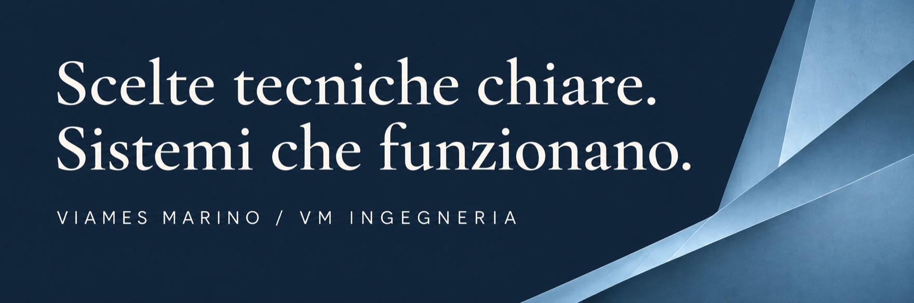

# Viames Marino

Affianco chi guida l’azienda nelle scelte tecniche e nella loro realizzazione.

**[Parliamo della tua priorità →](https://vmingegneria.it/#contatti)** · [Esplora i progetti](#codice-pubblico-metodo-consultabile)

## Quando posso esserti utile

- **Dati ricopiati e strumenti che non si parlano** — integrazioni e automazioni mirate, con AI quando è utile.
- **Software da far evolvere** — interventi progressivi e verificabili.
- **Scelte e fornitori da coordinare** — priorità, alternative e responsabilità chiare.

## Codice pubblico, metodo consultabile

**[Pair](https://github.com/viames/pair) + [plugin Codex](https://github.com/viames/pair-plugin)** — architettura, manutenzione e sei skill per sviluppare e rivedere le applicazioni Pair.

**[Pages Native](https://github.com/viames/pages-native) · [Numbers Native](https://github.com/viames/numbers-native)** — documenti e fogli nei formati nativi Apple, su macOS.

**[Aruba Cloud](https://github.com/viames/aruba-cloud-skill)** — inventari e confronti delle risorse cloud.

**[LG ThinQ](https://github.com/viames/homebridge-lg-thinq-system-boiler) · [PRANA](https://github.com/viames/homebridge-prana-local)** — integrazioni tra software e dispositivi attraverso Homebridge.

<strong>Come lavoro e altri progetti</strong>

Sono ingegnere e titolare di **VM Ingegneria**. Unisco esperienza pluridecennale su software e sistemi in produzione al coordinamento tecnico di gruppi e fornitori.

Il primo incarico può riguardare un processo o una decisione: **perimetro, tempi e condizioni si concordano prima di iniziare**. Se proseguiamo, seguo la realizzazione e la verifica degli interventi approvati.

Mantengo Pair in pubblico dal 2017. Le sue skill Codex lavorano sulla versione realmente installata. Le integrazioni native e i dispositivi supportati hanno verifiche e limiti di compatibilità espliciti nei rispettivi repository.

- **[ComposerGlass Engine](https://github.com/viames/ComposerGlassEngine)** — motore di dipendenze compatibile con Composer, scritto in Swift, con operazioni transazionali e ripristino.
- **[Governed AI Agent Blueprint](https://github.com/viames/governed-ai-agent-blueprint)** — riferimento eseguibile per autorizzazione dei dati, approvazione delle azioni e audit. È un’implementazione di riferimento assistita dall’AI, non un caso cliente in produzione.
- **[Pair Starter](https://github.com/viames/pair_boilerplate)** e **[documentazione di Pair](https://github.com/viames/pair/wiki)** — installazione, esempi e percorsi di sviluppo.

Ogni repository contiene istruzioni d’installazione, verifiche e limiti di compatibilità. I progetti sono indipendenti dai produttori e dalle piattaforme a cui si collegano.

Collaborazioni in italiano e in inglese.

